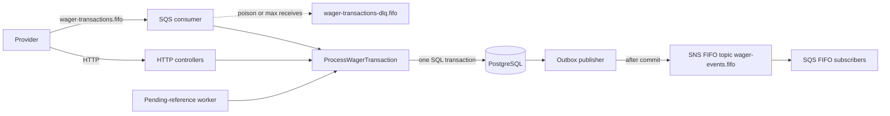

# Architecture

**Status:** approved by Matheus on 13 Nov 2026; every decision below was taken by him on 12 Nov. What is already implemented is tracked slice by slice in [docs/PROGRESS.md](docs/PROGRESS.md).

## 1. Shape of the system

- One NestJS application, run as N identical instances. Every instance serves HTTP, consumes the queue and runs the two background workers.
- PostgreSQL is the only source of truth and the only coordination mechanism between instances. Nothing that correctness depends on lives in memory.
- HTTP and SQS call the same use case, `ProcessWagerTransaction`.

| Layer | Contains | May import |
| --- | --- | --- |
| Domain | `Money`, `Wallet`, `WagerTransaction`, `WalletLedgerEntry`, integration events, failure codes, domain errors | Nothing outside the domain, except `decimal.js` inside `Money` |
| Application | Use cases and ports (repositories, clock, id generator, event publisher, provider identity) | Domain |
| Infrastructure | MikroORM records and mappers, migrations, SQS and SNS adapters, HTTP controllers, workers, logging, metrics | Application and domain |

A port exists only where it protects a boundary: persistence, the broker, time, identity.

## 2. The critical section

Every balance change runs this sequence inside one `em.transactional()` call, at `READ COMMITTED`.

1. Validate the payload outside the transaction: shape, closed field list, `Money`, `kind` is not `OPENING`, reference present for `REFUND` and `ROLLBACK`. Failure → 400, nothing persisted.
2. Compute `payloadHash`.
3. `BEGIN`.
4. SQS only: insert the inbox row `(consumer_name, message_id)`. If it already exists the message was already committed: stop and ack.
5. `SELECT … FOR UPDATE` on the wallet row. Unknown wallet → 404 (L-08).
6. Look up the transaction by `idempotency_key`. Same hash → replay of the stored result. Different hash → 409. Same provider + external id under another key → 409.
7. Check that the wallet belongs to the player and uses the operation currency. Otherwise persist `REJECTED`.
8. Resolve the reference by `(provider_id, reference_external_transaction_id)`. Missing → persist `PENDING_REFERENCE`. Found → validate ownership, kind, status, amount and that it was not reversed yet.
9. Apply the movement on the `Wallet` aggregate, producing the new balance, the new version and one ledger entry. Insufficient balance → `REJECTED`.
10. Persist the transaction with the observed balance, the ledger entry, the wallet row and the outbox events.
11. `COMMIT`. Only then: HTTP response, or `DeleteMessage` on SQS.

### Why this order

- **Lock first, then look up.** At `READ COMMITTED` each statement sees data committed before it started, and a `FOR UPDATE` that waited returns the latest row version. So whoever gets the lock second sees everything the first one committed, including its transaction row. That is what turns 50 parallel copies of one bet into one debit and 49 replays.
- **One wallet, one lock.** A transaction and its reference must belong to the same wallet (rule 7.2), so every row the use case reads or writes is protected by that single lock. Locking one row per transaction makes deadlock impossible.
- **The unique indexes are the backstop, not the mechanism.** The same key sent with a different `walletId` is not serialised by the lock. The unique index on `idempotency_key` rejects the second insert, the transaction rolls back, and the violation, recognised by the constraint name, is answered 409. It is always a conflict: the same hash implies the same `walletId`, hence the same lock and a replay found by the lookup. The unique index on provider + external id works the same way.
- **Inbox, effects and outbox commit together.** If the inbox row exists, the effects exist. If the process dies before the ack, the redelivery hits the inbox row and is acknowledged without a second effect.

## 3. Data model and database guarantees

Statement §5.9 requires uniqueness, immutability and non-negativity in the schema. Each guarantee below is a constraint, index or trigger, and each one gets an integration test.

| Table | Guarantee | Mechanism |
| --- | --- | --- |
| `wallets` | One wallet per player and currency | `UNIQUE (player_id, currency)` |
| `wallets` | Balance never negative | `CHECK (balance >= 0)` |
| `wallets` | Version starts at 1 | `CHECK (version >= 1)` |
| `wager_transactions` | One transaction per idempotency key | `UNIQUE (idempotency_key)` |
| `wager_transactions` | One transaction per provider and external id | `UNIQUE (provider_id, external_transaction_id)` |
| `wager_transactions` | One reversal per reference (L-01) | Partial unique index on `reference_transaction_id` where `kind in ('REFUND','ROLLBACK') and status = 'PROCESSED'` |
| `wager_transactions` | Reversals carry a reference and `BET`/`OPENING` refuse one (L-18); status and failure code are paired as in §6; the observed balance exists once a status is reached; movements are positive (L-03) | `CHECK` constraints |
| `wager_transactions` | Terminal rows never change; a pending row keeps its identity, leaves only for a terminal status and keeps its observed balance when it fails | Trigger rejecting `UPDATE` of a terminal row, of an identity column or towards a non-terminal status, and any `DELETE` or `TRUNCATE` |
| `wager_transactions` | The provider id `SYSTEM` belongs to the internal `OPENING`, and only to it | `CHECK ((provider_id = 'SYSTEM') = (kind = 'OPENING'))` |
| `wager_transactions` | A reference belongs to the same wallet (rule 7.2), so one wallet lock covers both rows | Composite foreign key `(reference_transaction_id, wallet_id)` to `(id, wallet_id)` |
| `wager_transactions` | A pending-reference row is always due and holds no resolved reference; `PENDING` is never committed (L-06) | `CHECK` constraints |
| `wallet_ledger_entries` | Append-only | Triggers rejecting `UPDATE`, `DELETE` and `TRUNCATE` |
| `wallet_ledger_entries` | At most one entry per transaction and wallet | `UNIQUE (transaction_id, wallet_id)` |
| `wallet_ledger_entries` | No lost update can ever be recorded | `UNIQUE (wallet_id, sequence)`, where `sequence` is the wallet version the entry produced |
| `wallet_ledger_entries` | Entry arithmetic | `CHECK` that `balance_after = balance_before ± amount` according to `direction`, `amount > 0`, `balance_after >= 0` |
| `wallet_ledger_entries` | An entry's currency is its wallet's and its account's; its wallet is its transaction's wallet | Composite foreign keys on `(wallet_id, currency)`, `(counterparty_account_id, currency)` and `(transaction_id, wallet_id)` |
| `wallet_ledger_entries` | Every entry names its counterparty account (ADR-12) | `counterparty_account_id NOT NULL` with a foreign key to `ledger_accounts` |
| `ledger_accounts` | One system account per kind, provider and currency | `UNIQUE NULLS NOT DISTINCT (kind, provider_id, currency)`; `CHECK` that only `PROVIDER_SETTLEMENT` has a provider |
| `inbox_messages` | A message is processed once per consumer | Primary key `(consumer_name, message_id)` |
| `outbox_messages` | Cheap scan of pending events | Partial index on `next_attempt_at` where `published_at is null` |

Money columns are `NUMERIC(19,2)` next to a `CHAR(3)` currency. The pending-reference worker uses a partial index on `next_attempt_at` where `status = 'PENDING_REFERENCE'`.

## 4. Decisions

### ADR-01 — Concurrency control (accepted)

- **Context.** Two bets may compete for one balance across three or more instances. No global lock, no unguarded read-calculate-update.
- **Options.** (a) Pessimistic `SELECT … FOR UPDATE` on the wallet row. (b) Optimistic locking on `version` with bounded retry. (c) Atomic conditional `UPDATE … WHERE balance >= amount`.
- **Decision.** (a), with `CHECK (balance >= 0)` and the unique ledger sequence as defence in depth.
- **Consequences.** Outcomes are deterministic and there are no retry storms on a hot wallet. The whole use case, not only the balance update, is serialised per wallet, which is what the idempotency and reversal checks need. Cost: requests for a hot wallet queue on a connection; a `lock_timeout` turns excessive waiting into 503. (b) wastes work exactly when contention is highest. (c) moves the rule into SQL and leaves `Wallet.debit()` decorative.

### ADR-02 — Money representation (accepted)

- **Context.** No `number` for money; fixed scale of 2; the domain cannot depend on ORM types.
- **Options.** Database: `NUMERIC(19,2)` or `BIGINT` minor units. Domain: `decimal.js`, `big.js` or native `bigint`.
- **Decision.** `NUMERIC(19,2)` plus `CHAR(3)`; `decimal.js` inside `Money`, on an isolated `Decimal.clone({ precision: 40 })`.
- **Consequences.** SQL stays readable and `SUM` is exact, which keeps reconciliation a single statement. The driver returns `NUMERIC` as a string, so no float appears at any point. The isolated instance matters: the default 20 significant digits would round large sums silently. Input is strict (L-02): exactly two decimals.

### ADR-03 — Idempotency and canonical hash (accepted)

- **Context.** Replay must return the original result; same key with a different payload is a conflict; nothing may rely on memory.
- **Options.** (a) The transaction row is the idempotency record. (b) A separate `idempotency_keys` table storing the HTTP response. (c) The same with an in-progress state.
- **Decision.** (a). The response is rebuilt from the persisted row: status, failure code and the balance observed when it was applied.
- **Hash.** SHA-256, hex, over canonical JSON of a closed field list: `providerId`, `externalTransactionId`, `playerId`, `walletId`, `roundId`, `gameId`, `kind`, `money.amount`, `money.currency`, and `referenceExternalTransactionId` when present. Keys sorted, no whitespace, UTF-8, every value a string, amount taken from the normalised `Money`. The header, `messageId`, `occurredAt` and `data.idempotencyKey` are excluded, so the same business request hashes identically over HTTP and SQS.
- **Consequences.** One source of truth and one fewer table to keep atomic. Unknown fields are rejected with 400, so nothing outside the hash can vary silently. Outcomes that are not persisted (400, 404) are not recorded; they are deterministic and have no effect.

### ADR-04 — Outbox publisher (accepted)

- **Context.** Events must survive a crash between commit and publish, with several publishers running.
- **Options.** (a) Polling with `FOR UPDATE SKIP LOCKED`, publishing while the rows are locked. (b) Lease columns with expiry. (c) (a) woken by `LISTEN/NOTIFY`.
- **Decision.** (a), batches of 10 (the `PublishBatch` limit), short client timeout.
- **Consequences.** A publisher that dies releases its locks with its connection and another instance picks the rows up: at-least-once, with no lease to tune. The transaction stays open during one bounded network call. Failed entries get `attempts + 1` and an exponential `next_attempt_at`; events are never dropped. Two publishers can invert the order of two batches of the same wallet, so consumers order by `walletVersion` and deduplicate by `eventId` (L-14).

### ADR-05 — Retry policies (accepted)

- **Pending references.** Backoff `min(60s, 1s × 2ⁿ)`, 10 attempts, about 5 minutes of real attempts. Attempt-based rather than a wall-clock TTL, so worker downtime does not consume the window. Exhausted → `REJECTED` with `REFERENCE_NOT_FOUND` and a `WagerTransactionRejected` event. The worker takes the wallet lock first and re-checks the row under it, so two workers never apply the same transaction.
- **SQS consumer.** Business outcome → commit and ack. Transient error → no ack, `ChangeMessageVisibility` with exponential backoff; the queue redrives to the DLQ after 5 receives. Permanent error (unreadable message, invalid payload, same `messageId` with a different hash) → the consumer sends it to the DLQ itself and deletes it, so it does not block its FIFO group for five cycles.
- **HTTP.** No server-side retry; transient failure → 503 with `Retry-After`, safe to resend with the same key.
- **Shutdown.** On `SIGTERM` the consumer stops polling, waits for in-flight messages up to a grace period, then returns the remaining ones with visibility 0.
- All values are environment variables; tests shrink them to milliseconds.

### ADR-06 — Failure codes and HTTP status (accepted)

- **Decision.** Status is derived from the persisted state, so the first call and its replay answer identically. Codes are flat and stable; section 6 has the table.
- **Consequences.** A provider decides by status alone: 4xx never retry unchanged, 503 retry with the same key, 202 poll or wait for the event.

### ADR-07 — SQS emulator (accepted)

- **Options.** (a) MiniStack. (b) LocalStack community pinned at `4.12`. (c) LocalStack latest, which requires an account and an auth token since March 2026.
- **Decision.** (b), image `localstack/localstack:4.12`. MiniStack is the fallback.
- **Consequences.** No token, no account, mature SQS and SNS emulation, verified on 12 Nov (see `docs/PROGRESS.md`). The image is frozen: no updates or security patches, acceptable for a local emulator. Visibility expiry has a granularity of about one second.

### ADR-08 — Authentication (accepted)

- **Decision.** Not implemented. The extension point is explicit: a global no-op `AuthGuard` and a `ProviderIdentityPort`. Section 8 describes the Keycloak design.
- **Consequences.** Zero evaluation points at risk, and adding an IdP later is additive.

### ADR-09 — Proving multi-instance correctness (accepted)

- **Options.** (a) The test runner spawns three real application processes. (b) Compose replicas driven with `docker compose kill`. (c) Three Nest applications in one process.
- **Decision.** (a), with the suites running inside a Linux container. `docker compose up --scale app=3` exists for demos and the load test.
- **Consequences.** Real processes, real PostgreSQL and SQS, the ability to kill one specific process and to inject a failpoint between commit and ack. Linux is required because Windows cannot deliver `SIGTERM` to a handler.

### ADR-10 — Domain and ORM mapping (accepted)

- **Options.** (a) Pure domain classes, separate persistence records, mappers calling `rehydrate`. (b) Map the domain classes directly. (c) Pure domain and hand-written SQL only.
- **Decision.** (a). Records are declared with MikroORM `defineEntity`, without decorators.
- **Consequences.** The domain imports no ORM code, and rehydration goes through `rehydrate` as statement §6.0 requires. Cost: one small mapper per aggregate.

### ADR-11 — Event topology (accepted)

- **Options.** (a) One SQS FIFO queue. (b) SNS FIFO topic with SQS FIFO subscriptions.
- **Decision.** (b). Topic `wager-events.fifo`; `MessageGroupId` is the wallet id, `MessageDeduplicationId` is the event id; subscriptions use raw delivery.
- **Consequences.** Real fan-out: a new consumer is a new subscription. Broker deduplication covers five minutes and is only an optimisation; consumers deduplicate by `eventId`.

### ADR-12 — Double-entry ledger (accepted)

- **Context.** The statement lists double-entry as an optional differential, and Matheus chose to include it. The statement also keeps `WalletLedgerEntry` with at most one entry per wallet per transaction, and forbids a lock shared by all wallets.
- **Options.**
  - (a) **Transfer row.** Each ledger row records both sides: the wallet and a counterparty system account. Balanced by construction, as in transfer-based ledgers. One insert, no new lock, no trigger.
  - (b) **Classic journal.** Two rows per transaction, one on the wallet and one on a system account, with a deferred constraint trigger checking that debits equal credits at commit.
  - (c) **Materialised system balances.** The system account becomes a row every transaction locks, which is the global lock statement §5.6 forbids.
- **Decision.** (a).
- **Model.**
  - `ledger_accounts` holds system accounts only: `FUNDING` per currency, the source of opening balances, and `PROVIDER_SETTLEMENT` per provider and currency, the counterparty of gameplay. A provider account is created on first use with `INSERT … ON CONFLICT DO NOTHING`.
  - Every `wallet_ledger_entries` row carries `counterparty_account_id`. `DEBIT` debits the wallet and credits the counterparty; `CREDIT` does the opposite. One row is one balanced posting.
  - `OPENING` posts against `FUNDING`. `BET`, `WIN`, `REFUND` and `ROLLBACK` post against the provider's settlement account.
  - The rule that picks the counterparty lives in the domain, as a query on `WagerTransaction` that names the kind of account (and the provider, for a settlement account). The repository resolves it to the account row when it inserts the entry; `Wallet` and `WalletLedgerEntry` do not carry an account id.
  - System accounts have no balance column and are never locked. Their balance is an aggregate over the ledger; for a provider it is bets minus wins, net of reversals.
- **Consequences.** There is no state in which debits and credits differ, so no trigger is needed. The rule of at most one entry per wallet per transaction still holds, and the concurrency design is untouched because no shared row is written. A trial-balance check compares, per currency, the sum of the materialised wallet balances with the net of the ledger: a global version of the per-wallet reconciliation. Trade-off: this is a transfer-style ledger, not a journal with separate debit and credit lines, so a wallet-to-wallet transfer would need a second posting. (b) was not chosen because it costs about twice as much and its errors surface only at `COMMIT`.

### ADR-13 — ORM and migrations (accepted)

- **Decision.** MikroORM 7, the statement's preferred option: explicit Unit of Work, `em.transactional()` and `LockMode`. Migrations are hand-written SQL classes with `up` and `down`, registered in a static list and run through the Migrator API.
- **Consequences.** The schema contains partial indexes, `CHECK` constraints and triggers that a generator would not produce, so hand-written SQL is the honest representation. Running migrations programmatically avoids the MikroORM CLI, whose TypeScript loaders do not include Bun. Each use case execution, queue message and worker iteration runs on its own forked `EntityManager`, so no identity map is shared across concurrent work.

## 5. Transaction state machine

| From | To | When |
| --- | --- | --- |
| `PENDING` | `PROCESSED` | Applied, including `LOSS` |
| `PENDING` | `REJECTED` | Business rule violated |
| `PENDING` | `PENDING_REFERENCE` | Reference not found yet |
| `PENDING_REFERENCE` | `PROCESSED` | Reference arrived and the movement was applied |
| `PENDING_REFERENCE` | `REJECTED` | Reference arrived and a rule failed, or attempts were exhausted |
| `PENDING`, `PENDING_REFERENCE` | `FAILED` | Permanent non-business error on a persisted transaction |

- `PROCESSED`, `REJECTED` and `FAILED` are terminal. Any transition from them throws `InvalidTransactionStateError`: a programming error, not a business path.
- `PENDING` is the initial in-memory state. HTTP is synchronous, so it is never committed (L-06).

## 6. Failure codes and HTTP status

| Situation | HTTP | Provider action |
| --- | --- | --- |
| `PROCESSED` | 200 | Done |
| `PENDING_REFERENCE` | 202 | Wait for the event or query the transaction |
| Invalid payload | 400 | Fix the payload |
| Unknown wallet or transaction | 404 | Fix the identifier |
| Idempotency or uniqueness conflict | 409 | Do not resend; the key or id is already used |
| `REJECTED` | 422 | Read `failureCode`; resending the same key replays the rejection |
| Transient infrastructure failure | 503 + `Retry-After` | Resend with the same key |

| `failureCode` | Meaning | Persisted |
| --- | --- | --- |
| `INSUFFICIENT_FUNDS` | `BET` larger than the balance | yes, `REJECTED` |
| `BALANCE_LIMIT_EXCEEDED` | A credit would take the balance beyond `NUMERIC(19,2)` | yes, `REJECTED` |
| `REVERSAL_WOULD_OVERDRAW` | Reversing a credit would make the balance negative | yes, `REJECTED` |
| `CURRENCY_MISMATCH` | Operation currency differs from the wallet currency | yes, `REJECTED` |
| `WALLET_PLAYER_MISMATCH` | The wallet belongs to another player | yes, `REJECTED` |
| `REFERENCE_NOT_FOUND` | The reference never arrived within the retry window | yes, `REJECTED` |
| `REFERENCE_MISMATCH` | The reference has another player, wallet, currency or round | yes, `REJECTED` |
| `REFERENCE_KIND_NOT_ALLOWED` | For example `REFUND` of a `WIN` | yes, `REJECTED` |
| `REFERENCE_NOT_PROCESSED` | The reference is `REJECTED` or `FAILED` | yes, `REJECTED` |
| `REFERENCE_AMOUNT_MISMATCH` | Reversal amount differs from the reference | yes, `REJECTED` |
| `REFERENCE_ALREADY_REVERSED` | The reference already has a processed reversal | yes, `REJECTED` |
| `PROCESSING_FAILED` | Permanent non-business error | yes, `FAILED` |
| `VALIDATION_ERROR`, `IDEMPOTENCY_KEY_REQUIRED` | Invalid request | no, 400 |
| `WALLET_NOT_FOUND`, `TRANSACTION_NOT_FOUND` | Unknown resource | no, 404 |
| `IDEMPOTENCY_KEY_CONFLICT`, `EXTERNAL_TRANSACTION_CONFLICT`, `WALLET_ALREADY_EXISTS` | Conflict | no, 409 |
| `SERVICE_UNAVAILABLE` | Transient failure | no, 503 |

## 7. Accepted interpretations

| # | Interpretation |
| --- | --- |
| L-01 | At most one processed reversal per reference, of any kind. A `ROLLBACK` of the `REFUND` itself stays allowed. Stricter than rule 7.4, to protect the "no duplicated credit" invariant. |
| L-02 | Amounts must have exactly two decimals; `"25"` and `"25.5"` are 400. |
| L-03 | `BET`, `WIN`, `REFUND` and `ROLLBACK` require a positive amount. `LOSS` and the opening balance accept zero. |
| L-06 | `PENDING` is the initial in-memory state and is never committed; HTTP is synchronous. The schema refuses it. |
| L-08 | A transaction for an unknown wallet is not persisted: 404 over HTTP; on SQS, ack with log, metric and inbox row. |
| L-09 | `WIN` and `LOSS` may reference a `BET`: a `PROCESSED` `BET` of the same player, wallet, currency and round. No amount check, and a reversed `BET` can still be referenced. The rules bind the reference, not the settlement of the round. |
| L-10 | A `REJECTED` or `FAILED` reference is `REFERENCE_NOT_PROCESSED`. A missing reference, or one that is itself `PENDING_REFERENCE`, makes the transaction wait as `PENDING_REFERENCE` (202). |
| L-16 | A currency is any ISO-4217 code by shape, three uppercase letters, with no allow-list; every currency is handled at a scale of two. The challenge runs in `BRL`, the model stays multi-currency. |
| L-17 | One amount has one spelling: digits, a dot and two decimals, with no sign, no whitespace, no leading zeros and at most 17 integer digits, the range of `NUMERIC(19,2)`. |
| L-18 | `REFUND` and `ROLLBACK` require a reference; `WIN` and `LOSS` accept one; `BET` and `OPENING` refuse one. A transaction cannot reference itself. Violations are invalid requests, not persisted rejections. |
| L-20 | The HTTP answer to `WALLET_PLAYER_MISMATCH` carries no `balance`: without authentication it would reveal another player's balance. The row and the internal event keep it. |

The remaining proposed interpretations are listed in [docs/spec/REQUIREMENTS.md](docs/spec/REQUIREMENTS.md) and move here as they are confirmed.

## 8. Authentication design (not implemented)

- Keycloak in Docker Compose with an imported realm. Each provider is a confidential client using the OAuth 2.0 client-credentials grant.
- The API is a resource server: it validates the JWT signature against the realm JWKS, plus issuer, audience and scope.
- `ProviderIdentityPort` returns the provider bound to the token. The use case rejects a request whose `providerId` differs from it.
- Health endpoints stay open. Queue messages are a trusted internal channel, but the provider identity inside the message still goes through the same domain validations.

## 9. Known limitations

- Fixed scale of two decimals for every currency. A code is validated by shape only, so a currency with another minor unit, such as JPY or KWD, is accepted and handled at two decimals, which is wrong for it; those currencies are out of scope.
- A `WIN` without a reference is credited without requiring a `BET` in the round.
- No round settlement (L-09): the reference rules bind the round and the kind, not the outcome of the bet. A `WIN` may reference a `BET` that was already refunded or rolled back; a `BET` already settled by a `WIN` can still be refunded (100 → `BET` 30 → 70 → `WIN` 75 → 145 → `REFUND` 30 → 175); several `WIN`s may reference the same `BET`. Closing it needs a round model (a settled flag or a unique processed settlement per `BET`), which the statement does not define.
- That a transaction's `playerId` is its wallet's owner is a rule of the use case (`WALLET_PLAYER_MISMATCH`), not of the schema: a rejected row stores the wrong player on purpose, so the guarantee would need a check limited to `PROCESSED` rows or a trigger (S4 review, m6).
- No global ordering of events; ordering is per wallet and best-effort across publisher batches.
- A hot wallet is processed serially by design; its throughput is bounded by the duration of one transaction.
- The emulator image is frozen and differs from AWS in timing details.
