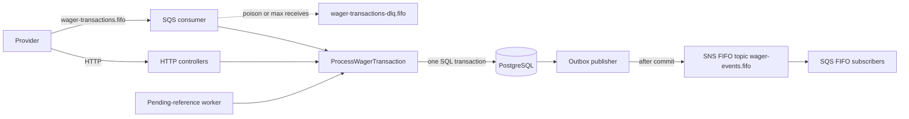

# Arquitetura

> Tradução de [ARCHITECTURE.md](ARCHITECTURE.md), gerada a partir da versão final em inglês. Em caso de divergência, vale o original. Identificadores, códigos e nomes de arquivos ficam como no código.

**Status:** final, 14 nov. 2026. Todas as decisões abaixo foram tomadas por Matheus; o ADR-14 e as interpretações datadas no §7 foram acrescentados durante a construção. O enunciado está em [docs/CHALLENGE.md](docs/CHALLENGE.md); como cada requisito é provado, em [docs/spec/REQUIREMENTS.md](docs/spec/REQUIREMENTS.md); o registro da construção, em [docs/PROGRESS.md](docs/PROGRESS.md).

## 1. Forma do sistema

- Uma aplicação NestJS, executada como N instâncias idênticas. Toda instância atende HTTP, consome a fila e roda os dois workers de background.
- O PostgreSQL é a única fonte de verdade e o único mecanismo de coordenação entre instâncias. Nada de que a correção dependa vive em memória.
- HTTP e SQS chamam o mesmo caso de uso, `ProcessWagerTransaction`.

| Camada | Contém | Pode importar |
| --- | --- | --- |
| Domínio | `Money`, `Wallet`, `WagerTransaction`, `WalletLedgerEntry`, `OutboxMessage`, eventos de integração, códigos de falha, erros de domínio | Nada fora do domínio, exceto `decimal.js` dentro de `Money` |
| Aplicação | Casos de uso e portas (repositórios, relógio, gerador de ids, publicador de eventos, identidade do provedor) | Domínio |
| Infraestrutura | Records e mappers do MikroORM, migrations, adaptadores SQS e SNS, controllers HTTP, workers, logs, métricas | Aplicação e domínio |

Uma porta só existe onde protege uma fronteira: persistência, broker, tempo, identidade.

## 2. A seção crítica

Toda mudança de saldo executa esta sequência dentro de uma única chamada `em.transactional()`, em `READ COMMITTED`.

1. Validar o payload fora da transação: formato, lista fechada de campos, `Money`, `kind` diferente de `OPENING`, referência presente para `REFUND` e `ROLLBACK`. Falha → 400, nada persistido.
2. Calcular o `payloadHash`. Por HTTP, perguntar à `ProviderIdentityPort` se o chamador pode agir pelo `providerId` (ADR-08). Recusado → 403, nada persistido.
3. `BEGIN`.
4. Só SQS: inserir a linha do inbox `(consumer_name, message_id)`. Se já existir, a mensagem já foi commitada: parar e dar ack.
5. `SELECT … FOR UPDATE` na linha da wallet. Wallet desconhecida → 404 (L-08).
6. Buscar a transação pela `idempotency_key`. Mesmo hash → replay do resultado gravado. Hash diferente → 409. Mesmo provedor + id externo com outra chave → 409.
7. Verificar que a wallet pertence ao jogador e usa a moeda da operação. Caso contrário, persistir `REJECTED`.
8. Resolver a referência por `(provider_id, reference_external_transaction_id)`. Ausente → persistir `PENDING_REFERENCE`. Encontrada → validar dono, tipo, status, valor e que ainda não foi revertida.
9. Aplicar o movimento no agregado `Wallet`, produzindo o novo saldo, a nova versão e um lançamento no ledger. Saldo insuficiente → `REJECTED`.
10. Persistir a transação com o saldo observado, o lançamento, a linha da wallet e os eventos do outbox.
11. `COMMIT`. Só então: resposta HTTP, ou `DeleteMessage` no SQS.

### Por que esta ordem

- **Primeiro o lock, depois a busca.** Em `READ COMMITTED` cada statement enxerga os dados commitados antes de começar, e um `FOR UPDATE` que esperou devolve a versão mais recente da linha. Assim, quem pega o lock em segundo enxerga tudo o que o primeiro commitou, inclusive a linha da transação. É isso que transforma 50 cópias paralelas de uma aposta em um débito e 49 replays.
- **Uma wallet, um lock.** Uma transação e sua referência precisam pertencer à mesma wallet (regra 7.2), então toda linha que o caso de uso lê ou escreve é protegida por esse único lock. Travar uma linha por transação torna o deadlock impossível. O caminho SQS pega um lock antes, a chave primária do inbox da sua mensagem (passo 4), e nada pega uma chave de inbox depois de um lock de wallet, então a ordem é sempre inbox → wallet e nenhum ciclo pode se formar (revisão do S9, m8).
- **Os índices únicos são a rede de segurança, não o mecanismo.** A mesma chave enviada com outro `walletId` não é serializada pelo lock. O índice único em `idempotency_key` recusa o segundo insert, a transação faz rollback, e a violação, reconhecida pelo nome da constraint, é respondida com 409. É sempre um conflito: o mesmo hash implica o mesmo `walletId`, portanto o mesmo lock e um replay encontrado pela busca. O índice único em provedor + id externo funciona igual.
- **Inbox, efeitos e outbox no mesmo commit.** Se a linha do inbox existe, os efeitos existem. Se o processo morre antes do ack, a reentrega bate na linha do inbox e recebe ack sem um segundo efeito.

## 3. Modelo de dados e garantias do banco

O enunciado §5.9 exige unicidade, imutabilidade e não-negatividade no schema. Cada garantia abaixo é uma constraint, índice ou trigger, e cada uma tem um teste de integração.

| Tabela | Garantia | Mecanismo |
| --- | --- | --- |
| `wallets` | Uma wallet por jogador e moeda | `UNIQUE (player_id, currency)` |
| `wallets` | Saldo nunca negativo | `CHECK (balance >= 0)` |
| `wallets` | Versão começa em 1 | `CHECK (version >= 1)` |
| `wager_transactions` | Uma transação por chave de idempotência | `UNIQUE (idempotency_key)` |
| `wager_transactions` | Uma transação por provedor e id externo | `UNIQUE (provider_id, external_transaction_id)` |
| `wager_transactions` | Uma reversão por referência (L-01) | Índice único parcial em `reference_transaction_id` onde `kind in ('REFUND','ROLLBACK') and status = 'PROCESSED'` |
| `wager_transactions` | Reversões têm referência e `BET`/`OPENING` recusam uma (L-18); status e código de falha andam juntos como no §6; o saldo observado existe assim que um status é alcançado; movimentos são positivos (L-03) | Constraints `CHECK` |
| `wager_transactions` | Linhas terminais nunca mudam; uma linha pendente mantém sua identidade, só sai para um status terminal e mantém o saldo observado quando falha | Trigger que recusa `UPDATE` de linha terminal, de coluna de identidade ou para status não terminal, e qualquer `DELETE` ou `TRUNCATE` |
| `wager_transactions` | O provider id `SYSTEM` pertence ao `OPENING` interno, e só a ele | `CHECK ((provider_id = 'SYSTEM') = (kind = 'OPENING'))` |
| `wager_transactions` | A referência pertence à mesma wallet (regra 7.2), então um único lock de wallet cobre as duas linhas | Foreign key composta `(reference_transaction_id, wallet_id)` para `(id, wallet_id)` |
| `wager_transactions` | Uma linha aguardando referência está sempre agendada e não tem referência resolvida; `PENDING` nunca é commitado (L-06) | Constraints `CHECK` |
| `wallet_ledger_entries` | Append-only | Triggers que recusam `UPDATE`, `DELETE` e `TRUNCATE` |
| `wallet_ledger_entries` | No máximo um lançamento por transação e wallet | `UNIQUE (transaction_id, wallet_id)` |
| `wallet_ledger_entries` | Nenhum lost update pode ser registrado | `UNIQUE (wallet_id, sequence)`, onde `sequence` é a versão da wallet que o lançamento produziu |
| `wallet_ledger_entries` | Aritmética do lançamento | `CHECK` de que `balance_after = balance_before ± amount` conforme `direction`, `amount > 0`, `balance_after >= 0` |
| `wallet_ledger_entries` | A moeda do lançamento é a da sua wallet e a da sua conta; a wallet do lançamento é a wallet da sua transação | Foreign keys compostas em `(wallet_id, currency)`, `(counterparty_account_id, currency)` e `(transaction_id, wallet_id)` |
| `wallet_ledger_entries` | Todo lançamento nomeia sua conta de contrapartida (ADR-12) | `counterparty_account_id NOT NULL` com foreign key para `ledger_accounts` |
| `ledger_accounts` | Uma conta de sistema por tipo, provedor e moeda | `UNIQUE NULLS NOT DISTINCT (kind, provider_id, currency)`; `CHECK` de que só `PROVIDER_SETTLEMENT` tem provedor |
| `inbox_messages` | Uma mensagem é processada uma vez por consumer | Chave primária `(consumer_name, message_id)` |
| `outbox_messages` | Varredura barata dos eventos pendentes | Índice parcial em `next_attempt_at` onde `published_at is null` |

As colunas de dinheiro são `NUMERIC(19,2)` ao lado de uma moeda `CHAR(3)`. O worker de referências pendentes usa um índice parcial em `next_attempt_at` onde `status = 'PENDING_REFERENCE'`.

## 4. Decisões

### ADR-01 — Controle de concorrência (aceito)

- **Contexto.** Duas apostas podem disputar um mesmo saldo entre três ou mais instâncias. Sem lock global, sem read-calculate-update desprotegido.
- **Opções.** (a) `SELECT … FOR UPDATE` pessimista na linha da wallet. (b) Optimistic locking em `version` com retry limitado. (c) `UPDATE … WHERE balance >= amount` atômico condicionado.
- **Decisão.** (a), com `CHECK (balance >= 0)` e a sequência única do ledger como defesa em profundidade.
- **Consequências.** Os resultados são determinísticos e não há tempestade de retries numa hot wallet. O caso de uso inteiro, não só a atualização do saldo, é serializado por wallet, que é o que as verificações de idempotência e de reversão precisam. Custo: requisições para uma hot wallet fazem fila segurando uma conexão; um `lock_timeout` (`DATABASE_LOCK_TIMEOUT_MS`, 5 s, definido em toda conexão desde o S9) transforma espera excessiva em erro transitório: retry no SQS, 503 com `Retry-After` por HTTP (S12). O `statement_timeout` (`DATABASE_STATEMENT_TIMEOUT_MS`, 10 s, acima do lock timeout porque também limita uma espera de lock) faz o mesmo para qualquer statement. (b) desperdiça trabalho justamente quando a contenção é maior. (c) leva a regra para o SQL e deixa `Wallet.debit()` decorativo.

### ADR-02 — Representação de dinheiro (aceito)

- **Contexto.** Nada de `number` para dinheiro; escala fixa de 2; o domínio não pode depender de tipos do ORM.
- **Opções.** Banco: `NUMERIC(19,2)` ou `BIGINT` em unidades menores. Domínio: `decimal.js`, `big.js` ou `bigint` nativo.
- **Decisão.** `NUMERIC(19,2)` mais `CHAR(3)`; `decimal.js` dentro de `Money`, numa instância isolada `Decimal.clone({ precision: 40 })`.
- **Mapeamento.** Os records do MikroORM declaram as colunas de dinheiro como `p.decimal().columnType('numeric(19,2)')`, cujo tipo JavaScript é `string`; os mappers constroem `Money.from({ amount, currency })` a partir da coluna e da coluna de moeda irmã, e gravam `Money.amount` de volta. `Money` nunca chega ao ORM e os records nunca guardam um `number`.
- **Consequências.** O SQL continua legível e o `SUM` é exato, o que mantém a reconciliação em um único statement. O driver devolve `NUMERIC` como string, então nenhum float aparece em ponto algum. A instância isolada importa: os 20 dígitos significativos padrão arredondariam somas grandes em silêncio. A entrada é estrita (L-02): exatamente duas casas decimais.

### ADR-03 — Idempotência e hash canônico (aceito)

- **Contexto.** O replay precisa devolver o resultado original; a mesma chave com payload diferente é conflito; nada pode depender de memória.
- **Opções.** (a) A linha da transação é o registro de idempotência. (b) Uma tabela `idempotency_keys` separada guardando a resposta HTTP. (c) O mesmo, com um estado "em andamento".
- **Decisão.** (a). A resposta é reconstruída da linha persistida: status, código de falha e o saldo observado quando foi aplicada.
- **Hash.** SHA-256, hex, sobre o JSON canônico de uma lista fechada de campos: `providerId`, `externalTransactionId`, `playerId`, `walletId`, `roundId`, `gameId`, `kind`, `money.amount`, `money.currency`, e `referenceExternalTransactionId` quando presente. Chaves ordenadas, sem espaços, UTF-8, todo valor string, valor tirado do `Money` normalizado. O header, `messageId`, `occurredAt` e `data.idempotencyKey` ficam de fora, então a mesma requisição de negócio gera o mesmo hash por HTTP e por SQS.
- **Consequências.** Uma única fonte de verdade e uma tabela a menos para manter atômica. Campos desconhecidos são recusados com 400, então nada fora do hash pode variar em silêncio. Resultados não persistidos (400, 404) não são registrados; são determinísticos e não têm efeito.

### ADR-04 — Publisher do outbox (aceito)

- **Contexto.** Os eventos precisam sobreviver a uma queda entre o commit e a publicação, com vários publishers rodando.
- **Opções.** (a) Polling com `FOR UPDATE SKIP LOCKED`, publicando enquanto as linhas estão travadas. (b) Colunas de lease com expiração. (c) (a) acordado por `LISTEN/NOTIFY`.
- **Decisão.** (a), lotes de 10 (o limite do `PublishBatch`), timeout curto no cliente.
- **Consequências.** Um publisher que morre libera seus locks junto com a conexão e outra instância pega as linhas (um host que some sem fechar o socket é limitado pelo `DATABASE_IDLE_IN_TRANSACTION_TIMEOUT_MS`, 15 s, que o servidor aplica em toda conexão da aplicação; revisão do S10, m1): at-least-once, sem lease para ajustar. A transação fica aberta durante uma chamada de rede limitada. Entradas que falham recebem `attempts + 1` e um `next_attempt_at` exponencial; eventos nunca são descartados. Dois publishers podem inverter a ordem de dois lotes da mesma wallet, então os consumidores ordenam por `walletVersion` e deduplicam por `eventId` (L-14).
- **Implementação (S10).** O `OutboxPublisher` roda em toda instância: varre as linhas vencidas na ordem `(next_attempt_at, id)` com o `PESSIMISTIC_PARTIAL_WRITE` do MikroORM (`FOR UPDATE SKIP LOCKED`), publica-as com um `PublishBatch` limitado por `OUTBOX_PUBLISH_TIMEOUT_MS` (3 s), e registra o resultado no `OutboxMessage` do statement (docs/tasks/S10.md, Q1): `markPublished`, ou `scheduleRetry` com `min(OUTBOX_RETRY_MAX_DELAY_MS, OUTBOX_RETRY_BASE_DELAY_MS × 2^(attempts-1))` e sem última tentativa. Uma entrada que o broker não listou como sucesso é retentada; uma chamada que falha ou estoura o timeout retenta o lote inteiro. No `SIGTERM` o lote em andamento faz commit ou rollback antes de o ORM fechar. Uma linha cuja publicação continua falhando fica na frente com atraso crescente; ela nunca bloqueia as outras, porque a varredura só pega linhas vencidas. Dois limites são aceitos (revisão do S10): um broker que aceita o lote mas sempre responde depois do timeout recebe o lote de novo a cada retry, e passada a janela de deduplicação de cinco minutos cada retry entrega mais uma cópia, seguro só porque os consumidores deduplicam por `eventId` (m3; as métricas do outbox do S11 devem mostrar `attempts > 1`); e `occurred_at` e o `now` da varredura vêm dos relógios das instâncias envolvidas, então diferença de relógio pode inverter dois eventos de uma wallet mesmo com um publisher, ou atrasar uma linha até o relógio do publisher alcançá-la (m4; L-14).

### ADR-05 — Políticas de retry (aceito)

- **Referências pendentes.** Backoff `min(60s, 1s × 2ⁿ)`, 10 tentativas, cerca de 4 minutos de tentativas reais. Por que 4 minutos: cobre, com folga, a janela de retry da própria transação referenciada no SQS (cerca de 75 s de backoff antes da DLQ, abaixo), então um `BET` atrasado pelos próprios retries ainda é encontrado; uma referência mais tardia que isso foi para a DLQ e precisa de um operador de qualquer forma, e segurar a reversão por mais tempo só atrasaria sua resposta. A busca da própria requisição não é uma tentativa: a linha já nasce vencida, e depois da tentativa k do worker a próxima vem `min(60s, 1s × 2^(k-1))` depois, então as tentativas acontecem em 0, 1, 3, 7, 15, 31, 63, 123, 183 e 243 s (docs/tasks/S7.md, Q2). Os eventos emitidos pelo worker mantêm o correlation id da requisição (L-15). Baseado em tentativas e não num TTL de relógio, para que o worker parado não consuma a janela. Esgotado → `REJECTED` com `REFERENCE_NOT_FOUND` e um evento `WagerTransactionRejected`, também quando a referência existe mas ela mesma ainda está esperando (L-10). O worker pega primeiro o lock da wallet e reverifica a linha sob ele, então dois workers nunca aplicam a mesma transação. Toda instância lê a mesma cabeça da fila; cada uma embaralha seu lote para se espalharem por wallets diferentes, mas o acúmulo de uma wallet ainda é drenado por uma instância de cada vez. Um retry que falha inesperadamente é adiado pelo atraso máximo, para não segurar a cabeça da fila. Uma falha transitória do banco (`src/infrastructure/persistence/transient-errors.ts`) nunca conta tentativa, então uma indisponibilidade nunca faz uma transação falhar; qualquer outro erro conta uma, e a tentativa que esgota a política torna a linha `FAILED` com `PROCESSING_FAILED` e um `WagerTransactionRejected` com esse código (L-07, docs/tasks/S12.md Q2).
- **Consumer SQS.** Resultado de negócio → commit e ack; inclui wallet desconhecida, cuja linha de inbox é commitada sozinha (L-08). Erro transitório → sem ack, `ChangeMessageVisibility` de `min(120s, 5s × 2^(receives-1))`; a fila faz o redrive para a DLQ depois de 5 recebimentos. Tudo o que não for classificado é transitório, então um erro inesperado ainda termina na DLQ, nunca é descartado. Erro permanente (mensagem ilegível, payload inválido, mesmo `messageId` com outro payload ou outra chave de idempotência, e os conflitos 409 `IDEMPOTENCY_KEY_CONFLICT` e `EXTERNAL_TRANSACTION_CONFLICT`, docs/tasks/S9.md Q1) → o próprio consumer copia a mensagem para a DLQ, com um atributo `failureReason` e o message id do broker como deduplication id, e depois a apaga, para não bloquear seu grupo FIFO por cinco ciclos. Cada instância roda `SQS_CONSUMER_CONCURRENCY` loops (5) que recebem uma mensagem cada (Q3): o SQS FIFO não entrega mais nada de um grupo enquanto uma mensagem dele está em processamento, então a ordem por wallet vale sem código; um lote contaria recebimentos das mensagens atrás de uma cabeça que falha e a redrive policy as mandaria para a DLQ sem tentativa. Um lock de wallet esperado por mais que `DATABASE_LOCK_TIMEOUT_MS` (5 s, ADR-01) é o erro transitório típico.
- **HTTP.** Sem retry no servidor; falha transitória → 503 com `Retry-After: 1` e `SERVICE_UNAVAILABLE`, seguro de reenviar com a mesma chave: em geral a unidade de trabalho não commitou nada, e quando a conexão caiu durante o `COMMIT` depois de o servidor ter commitado, o reenvio é um replay idempotente do resultado original. `POST /wallets` não tem chave de idempotência: um reenvio depois de uma abertura que commitou responde 409 `WALLET_ALREADY_EXISTS`, o que diz ao chamador que a wallet existe (revisão do S12, m6). Transitório significa um SQLSTATE das classes `08`, `53` ou `57`, ou `55P03`, `40001`, `40P01`, `25P03`, um erro de socket, ou o timeout de aquisição do pool (S12). Qualquer outro erro do driver é um 500 cujo log leva só o nome do erro, o código e a constraint, nunca a mensagem do driver (ela pode citar a linha). PostgreSQL inacessível também faz `/health/ready` responder 503.
- **Shutdown.** No `SIGTERM` o consumer não inicia novos recebimentos, espera as mensagens em processamento até `SQS_SHUTDOWN_GRACE_MS`, e devolve as restantes com visibilidade 0. Um long poll aberto não é abortado, e sim deixado terminar (`SQS_WAIT_TIME_S`, 10 s), e uma mensagem que ele traga é devolvida na hora: o broker pode entregar a um poll que o cliente já abandonou, e essa mensagem ficaria invisível por um visibility timeout inteiro sem ninguém trabalhando nela (descoberto no S9). O Compose dá 30 s para a aplicação parar.
- Todos os valores são variáveis de ambiente; os testes os reduzem a milissegundos.

### ADR-06 — Códigos de falha e status HTTP (aceito)

- **Decisão.** O status é derivado do estado persistido, então a primeira chamada e seu replay respondem igual. Os códigos são planos e estáveis; a tabela está na seção 6.
- **Consequências.** Um provedor decide só pelo status: 4xx nunca reenviar sem mudança, 503 reenviar com a mesma chave, 202 consultar ou esperar o evento.

### ADR-07 — Emulador de SQS (aceito)

- **Opções.** (a) MiniStack. (b) LocalStack community fixado em `4.12`. (c) LocalStack latest, que exige conta e auth token desde março de 2026.
- **Decisão.** (b), imagem `localstack/localstack:4.12`. MiniStack é o plano B.
- **Consequências.** Sem token, sem conta, emulação madura de SQS e SNS, verificada em 12 nov. (ver `docs/PROGRESS.md`). A imagem está congelada: sem atualizações nem patches de segurança, aceitável para um emulador local. A expiração de visibilidade tem granularidade de cerca de um segundo.

### ADR-08 — Autenticação (aceito)

- **Decisão.** Não implementada. O ponto de extensão está explícito no código (S13, Q3): um `AuthGuard` global no-op (`APP_GUARD`, `src/infrastructure/http/auth.ts`), onde um token seria verificado, e uma `ProviderIdentityPort` que `ProcessWagerTransaction.execute` consulta antes de abrir a transação; uma recusa é `PROVIDER_FORBIDDEN` (403) sem nada persistido. A implementação registrada, `ANY_PROVIDER`, aceita qualquer provedor. O caminho SQS não a consulta: a fila é um canal interno confiável (enunciado §2), e o provedor dentro da mensagem passa pelas mesmas regras de domínio. A seção 8 descreve o desenho com Keycloak.
- **Consequências.** Nenhum ponto da avaliação em risco, e adicionar um IdP é aditivo: um guard que verifica o JWT e guarda seu provedor no contexto da requisição, e uma implementação da porta que o compara. A verificação roda antes do `BEGIN` e fora do hash, então um chamador recusado não pega lock, e um replay da chave de outro provedor é recusado antes da busca. As leituras ainda não são protegidas (§9).

### ADR-09 — Como provar a correção com várias instâncias (aceito)

- **Opções.** (a) O runner de testes sobe três processos reais da aplicação. (b) Réplicas do Compose controladas com `docker compose kill`. (c) Três aplicações Nest num único processo.
- **Decisão.** (a), com as suítes rodando dentro de um container Linux. `docker compose up --scale app=3` existe para demonstrações e para o teste de carga.
- **Consequências.** Processos reais, PostgreSQL e SQS reais, a possibilidade de matar um processo específico e de injetar um failpoint entre o commit e o ack. É preciso Linux porque o Windows não entrega `SIGTERM` a um handler.

### ADR-10 — Domínio e mapeamento do ORM (aceito)

- **Opções.** (a) Classes de domínio puras, records de persistência separados, mappers chamando `rehydrate`. (b) Mapear as classes de domínio diretamente. (c) Domínio puro e só SQL escrito à mão.
- **Decisão.** (a). Os records são declarados com o `defineEntity` do MikroORM, sem decorators.
- **Consequências.** O domínio não importa código do ORM, e a reidratação passa por `rehydrate` como o enunciado §6.0 exige. Custo: um mapper pequeno por agregado.

### ADR-11 — Topologia de eventos (aceito)

- **Opções.** (a) Uma fila SQS FIFO. (b) Tópico SNS FIFO com assinaturas SQS FIFO.
- **Decisão.** (b). Tópico `wager-events.fifo`; `MessageGroupId` é o id da wallet, `MessageDeduplicationId` é o id do evento; as assinaturas usam raw delivery.
- **Consequências.** Fan-out real: um novo consumidor é uma nova assinatura. A deduplicação do broker cobre cinco minutos e é só uma otimização; os consumidores deduplicam por `eventId`.

### ADR-12 — Ledger de partidas dobradas (aceito)

- **Contexto.** O enunciado lista partidas dobradas como diferencial opcional, e Matheus escolheu incluí-las. O enunciado também mantém `WalletLedgerEntry` com no máximo um lançamento por wallet por transação, e proíbe um lock compartilhado por todas as wallets.
- **Opções.**
  - (a) **Linha de transferência.** Cada linha do ledger registra os dois lados: a wallet e uma conta de sistema de contrapartida. Balanceada por construção, como em ledgers baseados em transferências. Um insert, nenhum lock novo, nenhum trigger.
  - (b) **Diário clássico.** Duas linhas por transação, uma na wallet e uma numa conta de sistema, com um constraint trigger diferido verificando no commit que débitos e créditos batem.
  - (c) **Saldos de sistema materializados.** A conta de sistema vira uma linha que toda transação trava, que é o lock global que o enunciado §5.6 proíbe.
- **Decisão.** (a).
- **Modelo.**
  - `ledger_accounts` guarda só contas de sistema: `FUNDING` por moeda, origem dos saldos iniciais, e `PROVIDER_SETTLEMENT` por provedor e moeda, a contrapartida do jogo. A conta de um provedor é criada no primeiro uso com `INSERT … ON CONFLICT DO NOTHING`.
  - Toda linha de `wallet_ledger_entries` tem `counterparty_account_id`. `DEBIT` debita a wallet e credita a contrapartida; `CREDIT` faz o contrário. Uma linha é um lançamento balanceado.
  - `OPENING` lança contra `FUNDING`. `BET`, `WIN`, `REFUND` e `ROLLBACK` lançam contra a conta de liquidação do provedor.
  - A regra que escolhe a contrapartida vive no domínio, como uma consulta em `WagerTransaction` que nomeia o tipo de conta (e o provedor, para uma conta de liquidação). O repositório a resolve para a linha da conta ao inserir o lançamento; `Wallet` e `WalletLedgerEntry` não carregam id de conta.
  - Contas de sistema não têm coluna de saldo e nunca são travadas. O saldo delas é um agregado sobre o ledger; para um provedor, é apostas menos ganhos, líquido de reversões.
- **Consequências.** Não existe estado em que débitos e créditos difiram, então nenhum trigger é necessário. A regra de no máximo um lançamento por wallet por transação continua valendo, e o desenho de concorrência fica intacto porque nenhuma linha compartilhada é escrita. Uma verificação de trial balance compara, por moeda, a soma dos saldos materializados das wallets com o que as contas de sistema deram, líquido do que receberam de volta. Como cada linha é um lançamento balanceado, ela decorre da reconciliação por wallet e não pode falhar sozinha; é portanto uma verificação do helper de teste que toda suíte roda (`TRIAL_BALANCE` em `test/support/ledger-invariant.ts`), não um endpoint (decidido no S8). A foreign key para `ledger_accounts` pega um lock `FOR KEY SHARE` na linha da conta: não serializa nada, mas a linha da conta é compartilhada (revisão do S2, m6). Trade-off: é um ledger no estilo transferência, não um diário com linhas separadas de débito e crédito, então uma transferência entre wallets precisaria de um segundo lançamento. (b) não foi escolhido porque custa cerca do dobro e seus erros só aparecem no `COMMIT`.

### ADR-13 — ORM e migrations (aceito)

- **Decisão.** MikroORM 7, a opção preferencial do enunciado: Unit of Work explícito, `em.transactional()` e `LockMode`. As migrations são classes de SQL escritas à mão com `up` e `down`, registradas numa lista estática e executadas pela API do Migrator.
- **Consequências.** O schema tem índices parciais, constraints `CHECK` e triggers que um gerador não produziria, então SQL escrito à mão é a representação honesta. Rodar as migrations programaticamente evita a CLI do MikroORM, cujos loaders de TypeScript não incluem o Bun. Cada execução de caso de uso, mensagem da fila e iteração de worker roda no seu próprio `EntityManager` (fork), então nenhum identity map é compartilhado entre trabalhos concorrentes.

### ADR-14 — Métricas (aceito, S11)

- **Decisão.** `GET /metrics` serve o formato texto do Prometheus via `prom-client`, a partir de um registry de cada instância (nunca o global). Contadores e histogramas são movidos nas bordas que já veem o resultado (controller, consumer, worker, publisher, unit of work), não por uma porta da aplicação. O acúmulo é lido na hora do scrape: `outbox_lag_seconds` (`now() - min(occurred_at)` sobre as linhas não publicadas), `outbox_pending_messages`, `outbox_max_attempts` (ADR-04, m3) e `sqs_dlq_messages` (`ApproximateNumberOfMessages`, onde caem os movimentos da redrive policy, mais `ApproximateNumberOfMessagesNotVisible`, as mensagens da DLQ que alguém está lendo). Conflitos de lock são o 55P03 do `lock_timeout` visto pela unit of work, com `wallet_lock_wait_seconds` mostrando a contenção antes do timeout. Detalhes em docs/tasks/S11.md.
- **Famílias.** `wager_transactions_total{channel,status}` (cada status alcançado; um replay não é uma transação), `wager_transaction_processing_seconds{channel}`, `wager_duplicates_total{channel}`, `retries_total{source}` (`sqs`, `outbox`, `pending_reference`), `sqs_dead_lettered_total`, `sqs_unknown_wallet_messages_total`, `lock_conflicts_total`, `wallet_lock_wait_seconds`, `wallet_reconciliation_divergences_total`, e os quatro gauges acima.
- **Consequências.** Contadores são por processo e voltam a zero no reinício; um scraper os soma entre instâncias, e pega o máximo dos gauges, que toda instância lê do mesmo banco e da mesma fila. Um scrape custa uma query e uma chamada ao SQS (duas na primeira, que guarda a URL da DLQ); um gauge cuja leitura falha reporta `NaN`, nunca um valor velho. `outbox_lag_seconds` compara `occurred_at`, gravado com o relógio da instância, com o `now()` do banco, com piso em 0 (a premissa de relógio do L-14). `sqs_dead_lettered_total` avança quando a cópia chega à DLQ, antes do delete: um delete que falha envia a mensagem de novo, a DLQ a deduplica, e o contador a conta duas vezes (revisão do S11, m3, aceito). Rejeitados: formato texto escrito à mão (um histograma e escapes para manter), gauges medidos só pelo publisher e pelo consumer (cegos a um publisher parado e aos redrives), timeouts só para conflitos de lock.

## 5. Máquina de estados da transação

| De | Para | Quando |
| --- | --- | --- |
| `PENDING` | `PROCESSED` | Aplicada, inclusive `LOSS` |
| `PENDING` | `REJECTED` | Regra de negócio violada |
| `PENDING` | `PENDING_REFERENCE` | Referência ainda não encontrada |
| `PENDING_REFERENCE` | `PROCESSED` | A referência chegou e o movimento foi aplicado |
| `PENDING_REFERENCE` | `REJECTED` | A referência chegou e uma regra falhou, ou as tentativas se esgotaram |
| `PENDING`, `PENDING_REFERENCE` | `FAILED` | Erro permanente, não de negócio, numa transação persistida |

- `PROCESSED`, `REJECTED` e `FAILED` são terminais. Qualquer transição a partir deles lança `InvalidTransactionStateError`: um erro de programação, não um caminho de negócio.
- `PENDING` é o estado inicial em memória. O HTTP é síncrono, então ele nunca é commitado (L-06).

## 6. Códigos de falha e status HTTP

| Situação | HTTP | Ação do provedor |
| --- | --- | --- |
| `PROCESSED` | 200 | Nada |
| `PENDING_REFERENCE` | 202 | Esperar o evento ou consultar a transação |
| Payload inválido | 400 | Corrigir o payload |
| O chamador não pode agir pelo provedor (ADR-08; nunca hoje) | 403 | Usar as credenciais do próprio provedor |
| Wallet ou transação desconhecida | 404 | Corrigir o identificador |
| Conflito de idempotência ou de unicidade | 409 | Não reenviar; a chave ou o id já foi usado |
| `REJECTED` | 422 | Ler o `failureCode`; reenviar a mesma chave devolve a rejeição |
| `FAILED` | 422 | `PROCESSING_FAILED`: terminal, nada foi movimentado; reenviar a mesma chave devolve o mesmo resultado (docs/tasks/S12.md Q3) |
| Falha transitória de infraestrutura | 503 + `Retry-After` | Reenviar com a mesma chave; para `POST /wallets`, um 409 no reenvio significa que a primeira abertura foi commitada |

| `failureCode` | Significado | Persistido |
| --- | --- | --- |
| `INSUFFICIENT_FUNDS` | `BET` maior que o saldo | sim, `REJECTED` |
| `BALANCE_LIMIT_EXCEEDED` | Um crédito levaria o saldo além de `NUMERIC(19,2)` | sim, `REJECTED` |
| `REVERSAL_WOULD_OVERDRAW` | Reverter um crédito deixaria o saldo negativo | sim, `REJECTED` |
| `CURRENCY_MISMATCH` | A moeda da operação difere da moeda da wallet | sim, `REJECTED` |
| `WALLET_PLAYER_MISMATCH` | A wallet pertence a outro jogador | sim, `REJECTED` |
| `REFERENCE_NOT_FOUND` | A referência nunca chegou dentro da janela de retry | sim, `REJECTED` |
| `REFERENCE_MISMATCH` | A referência tem outro jogador, wallet, moeda ou rodada | sim, `REJECTED` |
| `REFERENCE_KIND_NOT_ALLOWED` | Por exemplo, `REFUND` de um `WIN` | sim, `REJECTED` |
| `REFERENCE_NOT_PROCESSED` | A referência está `REJECTED` ou `FAILED` | sim, `REJECTED` |
| `REFERENCE_AMOUNT_MISMATCH` | O valor da reversão difere do da referência | sim, `REJECTED` |
| `REFERENCE_ALREADY_REVERSED` | A referência já tem uma reversão processada | sim, `REJECTED` |
| `PROCESSING_FAILED` | Erro permanente, não de negócio | sim, `FAILED` |
| `VALIDATION_ERROR`, `IDEMPOTENCY_KEY_REQUIRED` | Requisição inválida | não, 400 |
| `PROVIDER_FORBIDDEN` | O chamador não pode agir pelo provedor da requisição (ADR-08) | não, 403 |
| `WALLET_NOT_FOUND`, `TRANSACTION_NOT_FOUND` | Recurso desconhecido | não, 404 |
| `IDEMPOTENCY_KEY_CONFLICT`, `EXTERNAL_TRANSACTION_CONFLICT`, `WALLET_ALREADY_EXISTS` | Conflito | não, 409 |
| `SERVICE_UNAVAILABLE` | Falha transitória | não, 503 |

## 7. Interpretações aceitas

| # | Interpretação |
| --- | --- |
| L-01 | No máximo uma reversão processada por referência, de qualquer tipo. Um `ROLLBACK` do próprio `REFUND` continua permitido. Mais estrito que a regra 7.4, para proteger a invariante "nenhum crédito duplicado". |
| L-02 | Valores precisam ter exatamente duas casas decimais; `"25"` e `"25.5"` são 400. |
| L-03 | `BET`, `WIN`, `REFUND` e `ROLLBACK` exigem valor positivo. `LOSS` e o saldo inicial aceitam zero. |
| L-04 | A chave de idempotência e o par provedor + id externo são duas identidades, cada uma única. O mesmo par com outra chave é 409 `EXTERNAL_TRANSACTION_CONFLICT`. No SQS, `data.idempotencyKey` faz o papel do header e fica fora do hash. |
| L-05 | Um replay devolve o estado persistido, inclusive o saldo observado quando a transação foi aplicada; para um status terminal esse é o resultado original, para uma transação em espera é o seu estado atual. |
| L-06 | `PENDING` é o estado inicial em memória e nunca é commitado; o HTTP é síncrono. O schema o recusa. |
| L-07 | `FAILED` só é alcançado por uma linha `PENDING_REFERENCE` persistida cujas tentativas continuam falhando com erro não transitório: cada uma conta uma tentativa, e a última a torna `FAILED` com `PROCESSING_FAILED`. Falhas transitórias nunca contam. O contador é o mesmo das buscas pela referência (`reference_attempts`, docs/tasks/S12.md Q2): uma linha com 9 buscas que depois falha uma vez termina `FAILED`, não `REFERENCE_NOT_FOUND`, e as falhas encurtam a janela de busca. Por HTTP e SQS, um erro inesperado faz rollback e nada é persistido. |
| L-08 | Uma transação para uma wallet desconhecida não é persistida: 404 por HTTP; no SQS, ack com log, métrica e linha de inbox, a linha de inbox commitando sozinha. |
| L-09 | `WIN` e `LOSS` podem referenciar um `BET`: um `BET` `PROCESSED` do mesmo jogador, wallet, moeda e rodada. Sem verificação de valor, e um `BET` revertido ainda pode ser referenciado. As regras amarram a referência, não a liquidação da rodada. |
| L-10 | Uma referência `REJECTED` ou `FAILED` é `REFERENCE_NOT_PROCESSED`. Uma referência ausente, ou que ela mesma está `PENDING_REFERENCE`, faz a transação esperar como `PENDING_REFERENCE` (202). Uma transação que esgota as tentativas enquanto a referência está ausente ou ainda esperando é `REJECTED` com `REFERENCE_NOT_FOUND`: o código significa que a referência nunca foi encontrada `PROCESSED` dentro da janela (revisão do S7, m2). |
| L-11 | Os eventos vão para um tópico SNS FIFO, `wager-events.fifo`, distribuído para assinaturas SQS FIFO (ADR-11). |
| L-12 | Recomenda-se aos produtores usar o id da wallet como `MessageGroupId` e o id da mensagem como `MessageDeduplicationId`. O consumer não depende de nenhum dos dois: a ordem por wallet vem do lock, a deduplicação do inbox. |
| L-13 | O cursor do ledger é o base64url de `<walletId>:<última sequência devolvida>`, em ordem crescente, recusado em outra wallet; a última página o mantém para que um leitor retome depois de novas escritas, e um leitor para em `hasMore === false`, não num cursor nulo. Keyset em `UNIQUE (wallet_id, sequence)`, então as páginas são estáveis sob escritas concorrentes. Padrão 50, no máximo 200 por página. |
| L-14 | Não há ordem global de eventos. Dentro de um lote as linhas saem na ordem `(next_attempt_at, id)` e o FIFO a mantém por wallet; dois publishers podem inverter dois lotes de uma wallet, uma linha retentada sai depois de outras mais novas, e a diferença de relógio entre instâncias pode inverter dois eventos de uma wallet. Os consumidores ordenam por `walletVersion` e deduplicam por `eventId`. |
| L-15 | O correlation id vem de `X-Correlation-Id` ou é gerado, e fica gravado na transação, então os eventos que o worker de referências pendentes emite depois o mantêm. |
| L-16 | Uma moeda é qualquer código ISO-4217 pelo formato, três letras maiúsculas, sem lista de permitidas; toda moeda é tratada com escala de dois. O desafio roda em `BRL`, o modelo continua multimoeda. |
| L-17 | Um valor tem uma única grafia: dígitos, um ponto e duas casas decimais, sem sinal, sem espaços, sem zeros à esquerda e com no máximo 17 dígitos inteiros, o alcance de `NUMERIC(19,2)`. |
| L-18 | `REFUND` e `ROLLBACK` exigem referência; `WIN` e `LOSS` aceitam uma; `BET` e `OPENING` a recusam. Uma transação não pode referenciar a si mesma. As violações são requisições inválidas, não rejeições persistidas. |
| L-19 | `POST /wallets` não tem chave de idempotência (enunciado §9): um reenvio depois de um 201 perdido é 409 `WALLET_ALREADY_EXISTS`, sem o id da wallet, porque respondê-lo transformaria o conflito numa busca por jogador para qualquer chamador enquanto não há autenticação. Uma busca por jogador e moeda é a correção aditiva. |
| L-20 | A resposta HTTP a `WALLET_PLAYER_MISMATCH` não traz `balance`: sem autenticação ela revelaria o saldo de outro jogador. A linha e o evento interno o mantêm. |

Todas as interpretações estão aceitas (L-04, L-05, L-11, L-12 e L-19 em 14 nov., S13 Q2); a pergunta por trás de cada uma está em [docs/spec/REQUIREMENTS.md](docs/spec/REQUIREMENTS.md) §3.

## 8. Desenho de autenticação (não implementado)

- Keycloak no Docker Compose com um realm importado. Cada provedor é um client confidencial usando o grant OAuth 2.0 client-credentials.
- A API é um resource server: valida a assinatura do JWT contra o JWKS do realm, além de issuer, audience e scope.
- O `AuthGuard` já registrado globalmente verifica o token e guarda seu provedor no contexto da requisição. A implementação da `ProviderIdentityPort` o compara com o `providerId` da requisição; o caso de uso já a chama e responde 403 `PROVIDER_FORBIDDEN` (ADR-08). As leituras por provedor + id externo fariam a mesma verificação.
- Os endpoints de health e o `/metrics` ficam abertos: o guard é global, então o guard real precisa isentá-los. As mensagens da fila são um canal interno confiável, mas a identidade do provedor dentro da mensagem continua passando pelas mesmas validações de domínio.

## 9. Limitações conhecidas

- Escala fixa de duas casas decimais para toda moeda. Um código é validado só pelo formato, então uma moeda com outra unidade menor, como JPY ou KWD, é aceita e tratada com duas casas, o que está errado para ela; essas moedas estão fora do escopo.
- Um `WIN` sem referência é creditado sem exigir um `BET` na rodada.
- Sem liquidação de rodada (L-09): as regras de referência amarram a rodada e o tipo, não o resultado da aposta. Um `WIN` pode referenciar um `BET` já estornado ou revertido; um `BET` já liquidado por um `WIN` ainda pode ser estornado (100 → `BET` 30 → 70 → `WIN` 75 → 145 → `REFUND` 30 → 175); vários `WIN`s podem referenciar o mesmo `BET`. Fechar isso exige um modelo de rodada (uma flag de liquidada ou uma liquidação processada única por `BET`), que o enunciado não define.
- Que o `playerId` de uma transação seja o dono da sua wallet é uma regra do caso de uso (`WALLET_PLAYER_MISMATCH`), não do schema: uma linha rejeitada grava o jogador errado de propósito, então a garantia exigiria um check limitado a linhas `PROCESSED` ou um trigger (revisão do S4, m6).
- Não há ordem global de eventos; a ordem é por wallet e best-effort entre lotes de publishers.
- `next_attempt_at` é gravado com o relógio da instância que fez a tentativa. Uma instância cujo relógio está s segundos adiantado pode retentar até s segundos antes, então a janela de cerca de 4 minutos pode encolher no máximo 10 × s. Saldo e idempotência não são afetados; é a mesma premissa de relógio do L-14.
- Uma mensagem recebida enquanto o PostgreSQL está inacessível conta um recebimento cada vez que volta, então uma indisponibilidade maior que o backoff do ADR-05 (5 + 10 + 20 + 40 s, cerca de 75 s) a manda para a DLQ em vez de esperar. Nada se perde e um redrive a reprocessa de forma idempotente, mas exige um operador. Fechar isso significa não receber enquanto o banco está inacessível (notas do S12).
- Um evento de `FAILED` é um `WagerTransactionRejected` com `PROCESSING_FAILED`: um consumidor distingue uma falha de uma rejeição de negócio só pelo código, e o saldo nele é o observado quando a linha começou a esperar, que o schema mantém.
- As leituras não têm autenticação (ADR-08): uma transação encontrada por provedor + id externo, que pode ser adivinhável, mostra seu saldo observado, exceto para `WALLET_PLAYER_MISMATCH` (L-20). O provedor ligado ao token fecha isso.
- A reconciliação soma créditos e débitos de uma wallet separadamente; uma soma além de `NUMERIC(19,2)` (10¹⁷ de movimento numa wallet) é recusada pelo `Money` e respondida com 500.
- Uma hot wallet é processada em série por desenho; sua vazão é limitada pela duração de uma transação (entre 166 e 251 transações/s, 4 a 6 ms cada, nas execuções de [docs/LOAD-TEST.md](docs/LOAD-TEST.md)).
- O publisher do outbox roda um loop por instância, um `PublishBatch` de 10 por vez. Sob carga sustentada ele fica atrás das escritas: a cerca de 1.290 transações/s em três instâncias o lag chegou a 36 s e foi drenado 44 s depois de a carga parar (docs/LOAD-TEST.md). Os eventos atrasam, nunca se perdem nem saem antes do commit. Vários loops por instância (a varredura com `SKIP LOCKED` permite) ou mais instâncias aumentariam a vazão.
- Um consumer que morre (ou é morto) com o long poll aberto pode deixar uma mensagem que o broker entregou a esse poll invisível por um visibility timeout (30 s) antes de outra instância recebê-la. Atrasada, nunca perdida; um `SIGTERM` gracioso evita isso.
- `ApproximateReceiveCount` é do broker: uma mensagem cujo processamento dura mais que o visibility timeout é recebida de novo e conta um recebimento mesmo com a primeira tentativa ainda em andamento. O inbox a mantém em um único efeito; ela pode chegar à DLQ antes de cinco falhas reais.
- A imagem do emulador está congelada e difere da AWS em detalhes de tempo.
- As métricas são por processo e se perdem no reinício (ADR-14); um scrape que encontra o SQS lento espera por ele, limitado só pelo timeout do scraper (a leitura do PostgreSQL é limitada pelo statement timeout). `/metrics` é aberto como os health checks: traz contagens e durações, nenhum valor monetário.
